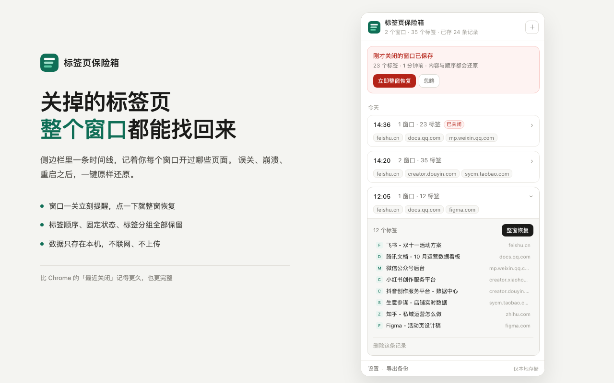

# 标签页保险箱 · Tab Vault

给浏览器装一台行车记录仪：**持续记录所有窗口和标签页的状态**，误关窗口、浏览器崩溃、重启之后，能把「当时那一刻」整窗还原回来。

Chrome 扩展 · Manifest V3 · 无联网、无上传、无统计



---

## 为什么需要它

Chrome 自带的历史记录救不了你。它是**按访问时间排列的流水账**，还会把同一个网址合并成一条——它能告诉你「三周前看过这篇文章」，但还原不出「2 号窗口那 23 个标签」这个集合。

而「最近关闭」只保留 **25 条**，关掉一个 20 标签的窗口只占 1 条记录，随便再关几次就被冲掉了。这就是「手滑关掉一个窗口，几十个页面再也找不回来」的真正原因。

这个扩展不去修补历史记录，而是另建一条**本地状态时间线**：每分钟检查一次所有窗口和标签，有变化才记一条快照。误关之后，从这条时间线里把整窗原样重建。

---

## 安装（3 分钟，不需要懂代码）

### 方式一：下载安装包（推荐）

1. 点进 [`dist/tab-vault-v1.0.0.zip`](dist/tab-vault-v1.0.0.zip)，在页面右上角点 **Download** 图标下载
2. 双击解压，得到一个 `tab-vault-v1.0.0` 文件夹
3. 打开 **Chrome 浏览器**，地址栏输入 `chrome://extensions` 回车
4. 打开页面**右上角的「开发者模式」开关**
5. 点左上角出现的 **「加载已解压的扩展程序」**，选择刚解压出来的那个文件夹（选文件夹本身）
6. 点工具栏右上角的**拼图图标**，找到「标签页保险箱」，点旁边的**图钉**固定
7. 点工具栏图标 → 选 **「打开时间线 →」**，侧边栏出现就装好了

### 方式二：下载整个仓库

点页面右上角绿色 **Code → Download ZIP**，解压后得到 `tab-vault-main` 文件夹，然后从上面的第 3 步开始做（选 `tab-vault-main` 文件夹）。

装好之后**不需要做任何操作**，正常用浏览器就行。

> 首次安装时 Chrome 会提示「开发者模式扩展」，这是本地加载扩展的正常提示，点「保留」即可。

---

## 怎么用

| 场景 | 操作 |
| --- | --- |
| 手滑关了整个窗口 | 弹出通知「已保存刚才关闭的窗口」，点「立即恢复」，整窗回来（顺序、固定标签、标签组都在） |
| 通知没看到 / 已消失 | 点插件图标 → 打开时间线，红色那条就是，点「立即整窗恢复」 |
| 浏览器崩了 / 强制退出 | 重开浏览器后，侧边栏顶部提示「疑似上次未正常关闭」，点「恢复这个会话」 |
| 只想从旧快照捞一个页面 | 时间线里点开对应那条 → 在标签列表里点那一个，只开它，不打扰当前工作 |
| 想把某刻的现场留档 | 时间线右上角「＋」手动存一条 |

---

## 它是怎么工作的

- 后台每 **1 分钟**检查一次，**标签有变化才写入**一条快照（没变化不产生垃圾数据）
- 标签新建 / 关闭 / 移动、窗口开关时，立刻补记一次
- 窗口关闭的那一刻，从浏览器里把整窗标签**抢救出来**单独存一条，并弹出通知
- 存储有上限：最近 40 条全留，1 天内全留，7 天内按小时抽稀，更早按天留，超过 90 天自动清理（可在设置里改）

---

## 隐私

- **所有数据只存在这台电脑的浏览器里**（IndexedDB，库名 `tabvault`）。扩展不联网、不上传、不做统计
- 只读取标签页的**网址、标题、图标、顺序、固定状态、分组**，不读取网页内容、表单、密码
- 无痕窗口不记录（扩展在无痕模式下不运行）
- 设置页可一键「清空全部记录」，卸载扩展数据随之删除

完整说明见 [隐私政策](https://parall.github.io/tab-vault-privacy/)。

---

## 备份与迁移

设置页 → 数据 → **导出备份文件**，得到一个 JSON（含全部快照和设置），可以丢网盘。换电脑后在新机器装好扩展 → **从备份导入**即可。

---

## 已知限制（诚实说明）

1. **浏览器扩展无法「拦截」关闭动作**——没有关闭前的钩子。所以是「关闭后 1 秒内恢复 + 通知你」，体感接近撤销，但不是阻止
2. `chrome://` 开头的内部页、扩展商店页等特殊页面，网址可能拿不到或无法重开，会漏掉这几个
3. 后台脚本会被浏览器休眠省电，靠定时器唤醒，极端崩溃场景下「最后一秒」的状态可能有几十秒缺口。日常误关不受影响（走实时事件）
4. 恢复时会跳过无法直接打开的 URL（如 `chrome://newtab`），其余标签顺序保持不变

---

## 文件结构

```
.
├── manifest.json          # 扩展配置（MV3）
├── background.js          # 后台：自动快照、误关捕获、崩溃守卫、通知
├── lib/
│   ├── util.js            # 设置、时间格式化、哈希等
│   ├── db.js              # IndexedDB 存储 + 分级清理
│   ├── model.js           # 快照数据模型
│   ├── restore.js         # 整窗恢复（顺序/固定/分组）
│   └── backup.js          # 导出导入
├── sidepanel/             # 主界面（时间线）
├── popup/                 # 工具栏弹窗
├── options/               # 设置页
├── icons/                 # 16/32/48/128 图标
├── docs/                  # 截图
└── dist/                  # 打包好的安装包
```

---

## 开发者备注

- Manifest V3，最低 Chrome 116（`sidePanel.open` 需要）
- 权限：`tabs`（读标签网址标题）、`sessions`（取回刚关闭窗口的标签）、`storage` + `unlimitedStorage`（本地存快照）、`alarms`（定时快照）、`notifications`（误关提醒）、`sidePanel`（主界面）
- **无 host permissions**，不向任何页面注入脚本，不使用远程代码
- 修改代码后重新打包：把 `manifest.json`、`background.js`、`lib`、`sidepanel`、`popup`、`options`、`icons` 压成 zip，`manifest.json` 必须在 zip 根目录
